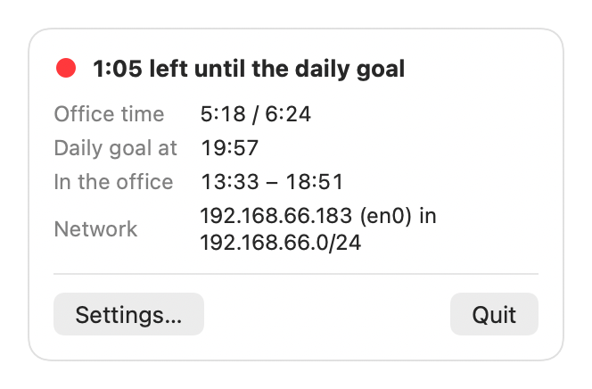

# Office Light

[](https://github.com/marcomattes/office-time-traffic-light/actions/workflows/ci.yml)

A tiny macOS menu bar app that shows whether you have spent enough time in the office today.

It detects the office by network (Wi-Fi SSID or IPv4 range), measures today's office time and shows it as a colored dot in the menu bar:

| Light | Meaning |
|-------|---------|
| ⚪ gray | no office time yet today |
| 🔴 red | daily goal not reached yet |
| 🟢 green | daily goal reached |

When the daily goal is reached you get a single macOS notification. Click the dot for today's office time, the time the daily goal will be reached, and which network matched.



## How it works

- **Office network**: a Wi-Fi SSID or an IPv4 range (CIDR) you configure. Several of each are allowed; any match counts.
- **Office time**: the span from the first to the last detection on an office network today. It resets at midnight.
- **Daily goal**: scheduled hours × quota. Defaults are 8 h × 80 % = 6:24.
- The app checks once a minute, on every network change, before sleep and after wake.
- Only today is kept (it survives a restart). There is no history.
- VPN tunnels (`utun`, `ipsec`, `ppp`) are ignored on purpose, so a VPN session from home with an office IP doesn't count.
- If the detection went wrong (the Wi-Fi flapped, the Mac stayed in the office overnight), *Reset today's office time* in Settings starts the day over.

See [GLOSSARY.md](GLOSSARY.md) for the terms used in the code and UI.

## Requirements

- macOS 14 Sonoma or later
- Xcode 26 or later to build from source

## Install

### Download

Grab `OfficeLight-<version>.zip` from the [latest release](https://github.com/marcomattes/office-time-traffic-light/releases/latest), unzip it and move `OfficeLight.app` to your Applications folder. The app is signed and notarized, so it opens without any Gatekeeper workaround.

### Build from source

```sh
scripts/install.sh
```

This builds the Release configuration and copies `OfficeLight.app` to `~/Applications`, then launches it.

By default the app is ad-hoc signed. That works, but macOS ties the Location Services permission to the code signature, so it asks again after every rebuild. To sign with your own Apple Development certificate, pass your team ID:

```sh
DEVELOPMENT_TEAM=ABCDE12345 scripts/install.sh
```

Or open `OfficeLight.xcodeproj` in Xcode, pick your team under *Signing & Capabilities* and run it from there.

## Permissions

The app asks for three things on first launch or in Settings:

- **Location Services**: macOS only reveals the Wi-Fi SSID to apps with location access. Your location itself is never read. Without this permission only the IP ranges are used.
- **Notifications**: for the one-time "daily goal reached" message.
- **Launch at login** (optional): toggled in Settings, registered via `SMAppService`.

## Privacy

Everything stays on your Mac. The app makes no network requests and stores its settings and today's record in its own `UserDefaults`. The SSID is masked in the menu (shown as `*****`) and only revealed in the tooltip, so it doesn't leak during screen sharing. A privacy manifest (`PrivacyInfo.xcprivacy`) is included.

## Languages

English and German. The UI follows the system language.

## Limitations

- IPv4 only.
- No history or statistics, no calendar awareness (on weekends the light simply stays gray).
- Time zone changes during a day are not handled.

## Development

Unit tests use Swift Testing and cover the logic that doesn't need a network: IP ranges, office time, the daily goal and the settings matching. They compile the app's sources directly, so they run without launching the app:

```sh
xcodebuild test -project OfficeLight.xcodeproj -scheme OfficeLight -destination 'platform=macOS'
```

CI runs the same command on every push and pull request. See [CONTRIBUTING.md](CONTRIBUTING.md) for conventions and [CHANGELOG.md](CHANGELOG.md) for what changed.

### Releasing

`scripts/release.sh` archives the app, signs it with your Developer ID, notarizes and staples it, and leaves a zip under `build/release/` ready to attach to a GitHub release. It needs a *Developer ID Application* certificate and stored `notarytool` credentials; the script header explains the one-time setup.

## Project layout

```
OfficeLight/
  OfficeLightApp.swift    App entry: menu bar extra and Settings scene
  OfficeLightModel.swift  Today's record, light state, periodic checks
  AppSettings.swift       Settings, office network matching, IPv4 ranges
  NetworkDetection.swift  SSID (CoreWLAN) and IPv4 addresses (getifaddrs), change events
  MenuView.swift          Menu bar icon and popover
  SettingsView.swift      Settings window
  Notifications.swift     Daily goal notification
  Assets.xcassets         App icon (generated by scripts/make-icon.swift)
  Localizable.xcstrings   UI strings (English source, German translation)
  InfoPlist.xcstrings     Localized usage descriptions
  PrivacyInfo.xcprivacy   Privacy manifest
OfficeLightTests/         Unit tests (Swift Testing)
Support/Info.plist        Usage descriptions for Location Services
scripts/install.sh        Build and install to ~/Applications
scripts/release.sh        Signed, notarized release build
scripts/make-icon.swift   Regenerates the app icon
.github/workflows/ci.yml  Build and test on every push
```

## License

[MIT](LICENSE)
